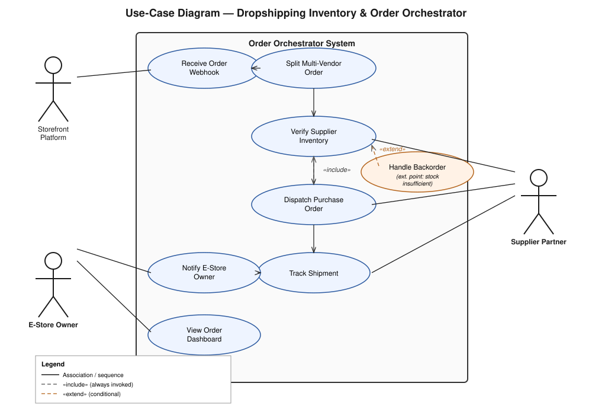
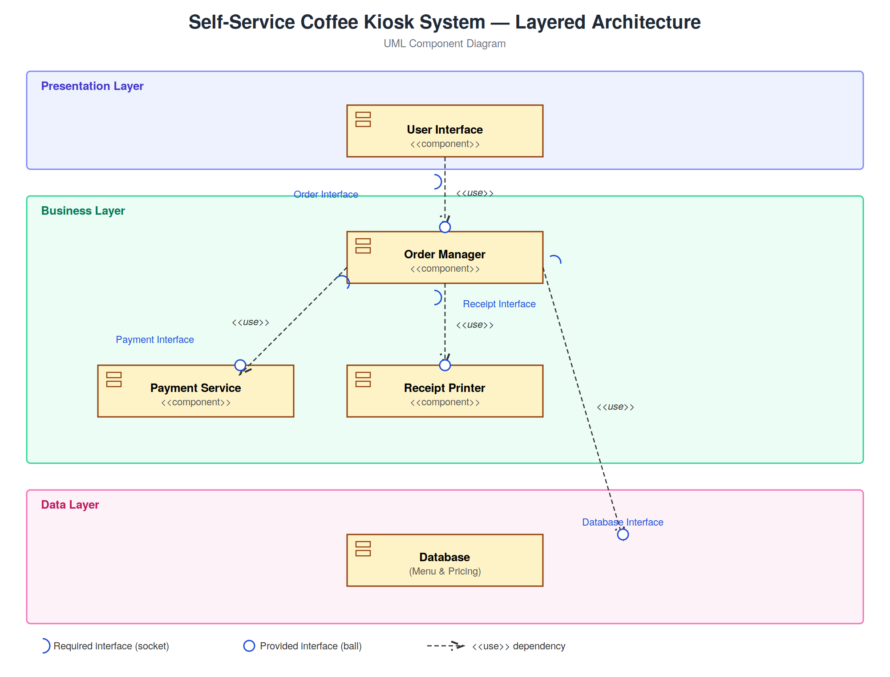

# Software Engineering Labs — Sem 5

Lab work for **UE24CS341A Software Engineering**, PES University.
**Gagan P** · PES1UG24CS166

| # | Lab | Topic | Deliverables |
|---|-----|-------|--------------|
| 1 | [Requirements Engineering](./lab1-requirements) | FRs/NFRs, use cases | Requirements table, UML use-case diagram, flow spec |
| 2 | [Agile Planning with Jira](./lab2-agile-jira) | Backlog, sprints, estimation | Sprint reflection report |
| 3 | [Software Architecture](./lab3-architecture) | Architecture style selection | Component diagram, justification |
| 4 | [AI-Assisted Debugging](./lab4-endless-runner) | LLM pair-programming | Fixed Pygame game, before/after videos, chat log |

---

## Lab 1 — Requirements Engineering

**Problem Statement #38: Dropshipping Inventory & Order Orchestrator** — a service that ingests Shopify/WooCommerce orders, splits multi-vendor orders, verifies live supplier stock and dispatches supplier POs.

- [`01-requirements-table.pdf`](./lab1-requirements/01-requirements-table.pdf) — 5 functional (FR-001–FR-005) and 2 non-functional requirements (200 ms webhook ack, idempotent PO dispatch), each with priority, acceptance criteria and rationale.
- [`02-use-case-diagram.svg`](./lab1-requirements/02-use-case-diagram.svg) — UML use-case diagram with `<<include>>` and `<<extend>>` relationships ([PlantUML source](./lab1-requirements/02-use-case-diagram.puml)).
- [`03-use-case-flow-spec.pdf`](./lab1-requirements/03-use-case-flow-spec.pdf) — flow spec for *Process Multi-Vendor Customer Order*: preconditions, postconditions, main success scenario and the out-of-stock alternate flow.

**Actors:** E-Store Owner · Supplier Partner · Storefront Platform



## Lab 2 — Agile Project Planning with Jira

Lab 1's requirements turned into a Jira backlog (project key `DIOO`) and run through two simulated one-week sprints.

- **4 epics, 15 user stories, 79 story points** (Fibonacci estimates, As-a / I-want / So-that format)
- **Sprint 1:** 26 / 29 points delivered (90%) · **Sprint 2:** in flight with one carried-over story
- [`sprint-reflection.pdf`](./lab2-agile-jira/sprint-reflection.pdf) — whether the estimates held, how good the prioritisation was, and how the plan compared with what got done

## Lab 3 — Software Architecture

**System:** Self-Service Coffee Kiosk. **Chosen style:** Layered Architecture (Presentation → Business → Data).

- **Why:** the scope is small and bounded on a single device, and hardware (printer, payment terminal) is handled in one place in the business layer
- **Security:** the UI never touches the Payment Service or DB directly, so the Order Manager is a single place to audit payments
- **Performance:** menu and pricing data changes rarely and is cached in the Order Manager

[Justification (.docx)](./lab3-architecture/Lab3_Architecture_Justification.docx)



## Lab 4 — Endless Runner (AI-Assisted Debugging)

A partly working Pygame endless runner, finished and fixed with an LLM as pair programmer.

| Task | What was done |
|------|---------------|
| Collision detection | Per-difficulty speed cap + swept collision, so fast obstacles can't pass through the player |
| Game over | Overlay shows the final score and waits for input |
| Replay | Restart on Easy / Medium / Hard (`1` / `2` / `3`), quit with `Esc` / `Q` |
| Sound | Jump, score and game-over sounds generated in code (no asset files) |

```bash
cd lab4-endless-runner
pip install -r requirements.txt
python main.py        # jump: Space / Up / W
```

Demo: [before](./lab4-endless-runner/demo/before.mp4) · [after](./lab4-endless-runner/demo/after.mp4) · [LLM chat history](./lab4-endless-runner/demo/chat-history.pdf)

Starter code: [SETAPESU26/39_endless-runner](https://github.com/SETAPESU26/39_endless-runner)

---

## Layout

```
.
├── lab1-requirements/     requirements table, use-case diagram, flow spec
├── lab2-agile-jira/       sprint reflection
├── lab3-architecture/     component diagram + justification
└── lab4-endless-runner/   game source, demo videos, chat log
```
